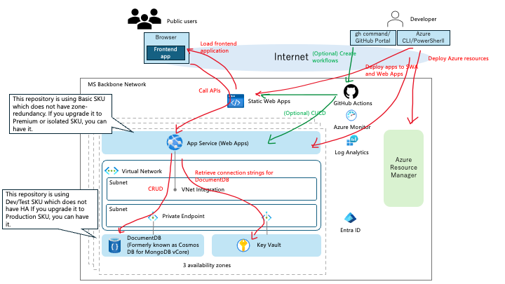

# Day 0: 事前準備 2 — サブスクリプションとリソースグループの設定

このページでは、Cloud Shell から Azure PaaS リソースを作成するためのサブスクリプション権限、リソースプロバイダー、リージョンと SKU の対応状況を確認し、作業用のリソースグループを作成します。

## 1. アーキテクチャを確認する



このワークショップでは、仮想マシン（VM）や OS を直接管理せず、Azure CLI と Bicep を使って PaaS 構成のブログアプリケーションを構築します。

全体像は次のとおりです。

| 領域 | Azure サービス | 役割 |
|---|---|---|
| フロントエンド | Azure Static Web Apps | React SPA を配信し、`/api/*` へのアクセスをバックエンドへルーティングします。 |
| バックエンド API | Azure App Service | Node.js API を実行し、Microsoft Entra ID のアクセストークンを検証します。 |
| データベース | Azure Cosmos DB for MongoDB vCore | ブログ記事やユーザー情報を保存します。 |
| シークレット管理 | Azure Key Vault | Cosmos DB の接続文字列などを保管し、App Service のマネージド ID から参照します。 |
| 監視・ログ | Application Insights / Log Analytics | アプリケーションのログ、依存関係、パフォーマンス、例外の調査に使用します。 |
| ネットワーク | VNet 統合 / Private Endpoint / NAT Gateway | App Service からプライベートエンドポイント経由でデータベースと Key Vault へ安全に接続します。 |

AWS に慣れている方は、EC2 インスタンスを自分で運用するのではなく、Amplify / Elastic Beanstalk、DocumentDB、Secrets Manager、CloudWatch Logs といったマネージドサービスを組み合わせる構成とイメージすると理解しやすくなります。

## 2. サブスクリプションを確認する

保存済みの共通変数を読み込み、現在選択されているサブスクリプションとテナントを確認します。

```bash
export WORKSHOP_REPO_DIR="${WORKSHOP_REPO_DIR:-$HOME/Azure-PaaS-Workshop}"
export WORKSHOP_STATE_DIR="${WORKSHOP_STATE_DIR:-$HOME/clouddrive/paas-workshop}"
source "$WORKSHOP_REPO_DIR/scripts/workshop-state.sh" || exit 1
workshop_state_load base || exit 1
az account show --query "{name:name,id:id,tenantId:tenantId}" --output table
```

Cloud Shell の現在のサブスクリプションが保存済みの値と異なる場合は、次のコマンドで切り替えてから再度読み込みます。

```bash
az account set --subscription "$SUBSCRIPTION_ID"
workshop_state_load base || exit 1
```

### サブスクリプションの Owner を確認する

このワークショップでは、対象サブスクリプション（または親の管理グループから継承されたスコープ）の **Owner（所有者）** ロールが必要です。PIM を利用している場合は、事前にロールを有効化してから次の確認コマンドを実行してください。

```bash
(
  set -euo pipefail
  SUBSCRIPTION_ID="$(az account show --query id -o tsv)"
  USER_OBJECT_ID="$(az ad signed-in-user show --query id -o tsv)"
  OWNER_ASSIGNMENTS="$(az role assignment list \
    --assignee "$USER_OBJECT_ID" \
    --scope "/subscriptions/$SUBSCRIPTION_ID" \
    --include-inherited \
    --include-groups \
    -o json)"
  if ! jq -e 'type == "array" and any(.[]; .roleDefinitionName == "Owner")' \
    <<< "$OWNER_ASSIGNMENTS" >/dev/null; then
    echo "ERROR: 対象サブスクリプションの Owner を確認できません。演習を開始せず講師に確認してください。" >&2
    exit 1
  fi
  echo "対象サブスクリプションの Owner 割り当てを確認しました。"
)
```

エラーが表示された場合は、Azure Portal の **サブスクリプション > 対象サブスクリプション > アクセス制御 (IAM) > アクセスの表示** で自分のロールと PIM の有効化状態を確認し、講師に相談してください。

## 3. リソースグループ名と権限を確認する

### Microsoft Entra ID のロールを確認する

Azure リソースと RBAC ロール割り当ての作成には **Azure サブスクリプションの Owner** を使用し、次のページで行うアプリ登録と本人同意には **Microsoft Entra ID の Application Developer（アプリケーション開発者）** を使用します。Entra ロールは Azure Portal の **Microsoft Entra ID > ロールと管理者** または **Privileged Identity Management > 自分のロール** で確認できます。

続けて、設定済みのリソースグループ名とリージョンを確認します。

```bash
echo "Resource group: $RESOURCE_GROUP"
echo "Primary region: $LOCATION"
echo "Static Web Apps region: $SWA_LOCATION"
printf 'Group: %s / Resource group: %s\n' "$GROUP_ID" "$RESOURCE_GROUP"
```

### 3.1 ロール割り当て権限（`roleAssignments/write`）を確認する

Day 1 の Bicep デプロイでは、App Service のマネージド ID に対して Key Vault のロールを割り当てます。次のスクリプトを実行し、対象スコープで `Microsoft.Authorization/roleAssignments/write` が許可されていることを確認します。

```bash
node scripts/check-role-assignment-permission.cjs \
  "$SUBSCRIPTION_ID" "$TENANT_ID" "$RESOURCE_GROUP" || exit "$?"
```

| 終了コード | 意味 | 対処 |
|---|---|---|
| `0` | ロール割り当ての作成権限が確認できた | 次のステップへ進みます |
| `3` (`BLOCKED`) | `Microsoft.Authorization/roleAssignments/write` の権限がない | サブスクリプションの Owner ロールが有効になっているか確認してください |
| `1` | テナント不一致や CLI / API エラー | `az account show` でサインイン状態とサブスクリプションを確認してください |

## 4. リソースプロバイダーを登録する

このワークショップでは、App Service、Static Web Apps、Cosmos DB (MongoDB vCore)、Key Vault、Azure Monitor / Alerts、Virtual Network を使用します。必要なリソースプロバイダーが登録されているか確認し、未登録のものがあれば登録します。

```bash
for ns in \
  Microsoft.Web \
  Microsoft.DocumentDB \
  Microsoft.KeyVault \
  Microsoft.Insights \
  Microsoft.AlertsManagement \
  Microsoft.OperationalInsights \
  Microsoft.Network \
  Microsoft.Authorization
do
  info="$(az provider show --subscription "$SUBSCRIPTION_ID" --namespace "$ns" \
    --query '{state:registrationState,policy:registrationPolicy}' -o json)" || exit 1
  state="$(printf '%s' "$info" | jq -er '.state')" || exit 1
  policy="$(printf '%s' "$info" | jq -r '.policy')" || exit 1
  printf '%s: %s / %s\n' "$ns" "$state" "$policy"
  if [ "$state" = Registered ] || [ "$policy" = RegistrationFree ]; then continue; fi
  case "$state" in
    NotRegistered)
      az provider register --subscription "$SUBSCRIPTION_ID" --namespace "$ns" --output none || exit 1 ;;
    Registering) ;;
    *) echo "想定外の provider 状態です。"; exit 1 ;;
  esac
  for attempt in $(seq 1 20); do
    state="$(az provider show --subscription "$SUBSCRIPTION_ID" --namespace "$ns" \
      --query registrationState -o tsv)" || exit 1
    printf '%s: %s (%s/20)\n' "$ns" "$state" "$attempt"
    case "$state" in
      Registered) break ;;
      Registering|NotRegistered) ;;
      *) echo "Provider 登録が正常に進んでいません。"; exit 1 ;;
    esac
    if [ "$attempt" -eq 20 ]; then echo "Provider 登録待ちを打ち切りました。"; exit 1; fi
    sleep 15
  done
done
```

一覧で登録状態を確認します。

```bash
for ns in Microsoft.Web Microsoft.DocumentDB Microsoft.KeyVault Microsoft.Insights Microsoft.AlertsManagement Microsoft.OperationalInsights Microsoft.Network Microsoft.Authorization
do
  az provider show --subscription "$SUBSCRIPTION_ID" --namespace "$ns" \
    --query "{namespace:namespace,state:registrationState,policy:registrationPolicy}" -o table || exit 1
done
```

各プロバイダーの `state` が `Registered`（または `policy` が `RegistrationFree`）になっていれば準備完了です。特に `Microsoft.AlertsManagement` が未登録のままだと、Application Insights のスマート検出ルール作成時にデプロイエラーになることがあるため注意してください。

## 5. リージョン・SKU・クォータを確認する

ワークショップの標準手順では、コストを抑えた次の SKU を使用します。

| リソース | 標準設定 | 補足 |
|---|---|---|
| App Service Plan | `B1` (Linux) | 1 インスタンス構成 |
| Static Web Apps | `Standard` | Linked Backend（`/api/*` ルーティング）の利用に必要 |
| Cosmos DB for MongoDB vCore | `M25` | 1 シャード・128 GiB（開発・検証向けティア） |
| Cosmos DB 高可用性 (HA) | `false` | `M25` ではゾーン冗長 HA は利用しません |

> Static Web Apps の Linked Backend 機能は `Free` プランでは利用できないため、`Standard` プランを使用します。

### リージョンとリソース種別の対応状況を確認する

次のスクリプトを実行し、選択したリージョン（`$LOCATION` と `$SWA_LOCATION`）で各リソース種別と App Service `B1` SKU が提供されていることを確認します。

```bash
node scripts/check-paas-catalog.cjs \
  "$SUBSCRIPTION_ID" "$TENANT_ID" "$LOCATION" "$SWA_LOCATION" B1 || exit 1
```

出力に `"status": "catalog_checks_passed"` が表示されれば、リージョンとリソースカタログの事前チェックは完了です。

> **補足（クォータエラーが発生した場合）:**
> カタログ上でリージョンが対応していても、サブスクリプションのクォータ制限やリージョンの一時的な容量制限により、Day 1 の Bicep デプロイ時に App Service Plan（`B1`）や Cosmos DB（`M25`）の作成が拒否される場合があります。必要に応じて次のコマンドで App Service の使用量・上限を確認し、上限が `0` になっている場合は講師に相談してください。
>
> ```bash
> QUOTA_SCOPE="/subscriptions/$SUBSCRIPTION_ID/providers/Microsoft.Web/locations/$LOCATION"
> az rest --subscription "$SUBSCRIPTION_ID" --method get \
>   --url "https://management.azure.com${QUOTA_SCOPE}/usages?api-version=2026-07-15" \
>   --query "{quotas:value[?name.value=='B1'].{name:name.value,currentValue:currentValue,limit:limit,unit:unit}}" \
>   --output json
> ```

## 6. 作業用リソースグループを作成する

演習用のリソースグループを作成します。すでに同名のリソースグループが存在する場合は、このワークショップ用のタグ（`Workshop=Azure-PaaS-Workshop` および `GroupId`）が付いていることを確認します。

```bash
GROUP_EXISTS="$(az group exists --subscription "$SUBSCRIPTION_ID" --name "$RESOURCE_GROUP")" || exit 1
case "$GROUP_EXISTS" in
  false)
    az group create --subscription "$SUBSCRIPTION_ID" \
      --name "$RESOURCE_GROUP" --location "$LOCATION" \
      --tags Workshop=Azure-PaaS-Workshop GroupId="$GROUP_ID" || exit 1 ;;
  true)
    TAGS="$(az group show --subscription "$SUBSCRIPTION_ID" --name "$RESOURCE_GROUP" --query tags -o json)" || exit 1
    printf '%s' "$TAGS" | jq -e --arg group "$GROUP_ID" \
      '.Workshop == "Azure-PaaS-Workshop" and .GroupId == $group' >/dev/null || {
      echo "既存 RG の workshop/group tag が一致しません。対象を確認し、上書きしないでください。"
      exit 1
    } ;;
  *) echo "RG の存在確認結果が不正です。"; exit 1 ;;
esac
```

作成されたリソースグループを確認します。

```bash
az group show --name "$RESOURCE_GROUP" --output table
```

## 次に進む

- [Day 0: Entra ID と認証設定](day-0-entra-id.ja.html)
